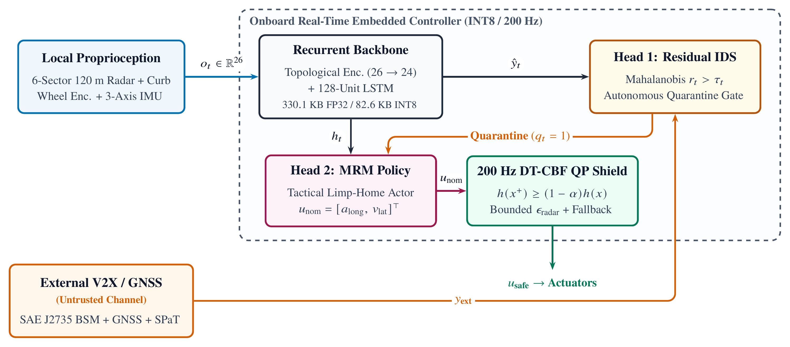

# RecurrentShield-V2X

[-0072B2.svg)](paper/recurrent_shield_v2x_ieee.tex)
[](data/usdot_manifest.json)
[](edge_deploy/esp32_s3_firmware/model_weights.cc)
[](tests/test_recurrent_shield_suite.py)

**Autonomous V2X/GNSS Quarantine and CBF-Enforced Tactical Limp-Home Control on Real USDOT Multi-Lane Highway & Arterial Corridors.**

`RecurrentShield-V2X` eliminates synthetic toy-maze assumptions by formulating cyber-resilient Connected and Automated Vehicle (CAV) navigation as a **Tactical Minimum-Risk Maneuver (MRM) & GNSS/V2X-Denied Limp-Home POMDP** evaluated directly on live-fetched USDOT NGSIM trajectories mapped to standardized SAE J2735 Basic Safety Messages (BSMs), acting as a last-line physical residual and safety shield when cryptographic V2X checks (IEEE 1609.2) are bypassed or compromised.

---

## Core Architecture & Live Demo

| Dual-Head LSTM + 200 Hz DT-CBF Loop | Zero-Shot Multi-Corridor Survival (5 Seeds) |
| :---: | :---: |
|  |  |

* **1080p 60fps Technical Demo Video:** [`results/linkedin_demo_recurrent_shield.mp4`](results/linkedin_demo_recurrent_shield.mp4) (15.0 s, H.264, `1920x1080`, `60 fps` — live US-101 GNSS ramp-spoof detection, autonomous V2X quarantine, and zero-collision limp-home).
* **Compiled IEEE Manuscript & Source:** [`paper/recurrent_shield_v2x_ieee.pdf`](paper/recurrent_shield_v2x_ieee.pdf) / [`paper/recurrent_shield_v2x_ieee.tex`](paper/recurrent_shield_v2x_ieee.tex) (`IEEEtran` two-column with POMDP formulation, Related Work across 4 subdomains, Theorem 1 DT-CBF local invariance under stated assumptions, $\alpha$-sensitivity & QP feasibility checks, per-attack/intermittent threat evaluation, and MCU profiling).

### Dual-Head `RecurrentShieldPPO` + Closed-Form 200 Hz DT-CBF Shield
1. **Topological Relational Encoder (`26 -> 24`) + 128-Unit LSTM (`84,505` params):** Encodes ego-centric 6-sector 120 m automotive radar/LiDAR clearances, sector validity masks, road-curb lateral anchors, wheel encoders, and 3-axis IMU for zero-shot corridor transfer.
2. **Head 1 — Mahalanobis Kinematic Residual Quarantine:** Predicts expected 6D anchor residuals $\hat{y}_t$ and latches quarantine whenever $r_t > \tau_t$ over consecutive frames, isolating spoofed GNSS/BSM/SPaT feeds while anchoring lateral dead-reckoning to road curbs.
3. **Head 2 — Tactical MRM Policy + 200 Hz DT-CBF KKT Shield:** Solves a separable diagonal 2D DT-CBF QP analytically in $O(1)$ (`480` Xtensa LX7 cycles / `2.0 µs` @ 240 MHz) with conservative reachability inflation ($\epsilon_{\text{radar}} = 0.85\text{ m}$ nominal, $1.85\text{ m}$ blinded) and deterministic emergency-brake fallback on constraint infeasibility.

---

## Real USDOT Dataset Reproduction (Zero Synthetic Traffic)

Raw trajectories are queried directly from the live USDOT Socrata REST API and verified via SHA-256 checksums in [`data/usdot_manifest.json`](data/usdot_manifest.json):

* **Primary Trajectory Dataset:** USDOT NGSIM Vehicle Trajectories — [`https://data.transportation.gov/resource/8ect-6jqj.json`](https://data.transportation.gov/resource/8ect-6jqj.json) (DOI: `10.21949/1504477`)
* **Secondary V2X Schema:** USDOT Safety Pilot Model Deployment (SPMD) SAE J2735 BSM (`msgCnt`, `id`, `lat`, `lon`, `speed`, `heading`, `accelSet`, DOI: `10.21949/1504482`)

| Corridor | Split Role | Records | Vehicles | Frames | Raw SHA-256 Prefix |
| :--- | :--- | :---: | :---: | :---: | :--- |
| **US-101** (Hollywood Fwy, LA) | Training & In-Dist. Eval | 33,395 | 227 | 171 | `8da1254ce4ff...` |
| **I-80** (Emeryville, CA) | Zero-Shot Highway Eval | 48,397 | 289 | 222 | `2c097fac4f59...` |
| **Lankershim Blvd** (Universal City) | Zero-Shot Arterial Eval | 43,142 | 157 | 357 | `20180d01aae2...` |
| **50k API Integrity Sample** | Live Endpoint Verification | 49,949 | — | — | `63633ddc7feb...` |

---

## 5-Seed Zero-Shot Benchmark Summary (6 Methods × 6 Attacks)

Models are trained across 5 random seeds (`101, 202, 303, 404, 505`) **only on real US-101 traffic** under matched `Adam(lr=2.5e-3)` compute parity, and evaluated zero-shot across unseen **I-80** and **Lankershim** against 6 parameterized SAE J2735 threats (`gnss_ramp_spoof`, `ghost_vehicle_fdi`, `spat_phase_inversion`, `sybil_bsm_flood`, `radar_sector_blinding`, `combined_spoof_blinding`):

| Corridor (Split) | Method | AUROC $\uparrow$ | Det. Delay (ms) $\downarrow$ | Limp-Home (%) $\uparrow$ | Collision (%) $\downarrow$ | RMS Jerk ($\text{m/s}^3$) $\downarrow$ |
| :--- | :--- | :---: | :---: | :---: | :---: | :---: |
| **US-101** (In-Dist.) | **RecurrentShield-V2X** | 0.964 $\pm$ 0.027 | 552.6 $\pm$ 27.9 | 96.7 $\pm$ 6.7 | 3.3 $\pm$ 6.7 | 5.56 $\pm$ 0.95 |
| US-101 | Ablation (No DT-CBF) | 0.984 $\pm$ 0.009 | 552.6 $\pm$ 27.9 | 80.0 $\pm$ 26.7 | 20.0 $\pm$ 26.7 | 1.82 $\pm$ 0.10 |
| US-101 | TCN-Residual IDS | 0.982 $\pm$ 0.010 | 725.9 $\pm$ 40.3 | **100.0 $\pm$ 0.0** | **0.0 $\pm$ 0.0** | 5.54 $\pm$ 2.82 |
| US-101 | Tiny-Transformer IDS | 0.990 $\pm$ 0.006 | 702.6 $\pm$ 10.5 | 96.7 $\pm$ 6.7 | 3.3 $\pm$ 6.7 | 6.43 $\pm$ 2.60 |
| US-101 | Stateless PPO | 0.986 $\pm$ 0.003 | 739.3 $\pm$ 41.4 | 96.7 $\pm$ 6.7 | 3.3 $\pm$ 6.7 | 2.48 $\pm$ 0.27 |
| US-101 | EKF-CUSUM + DT-CBF | 0.984 $\pm$ 0.001 | 212.6 $\pm$ 20.0 | **100.0 $\pm$ 0.0** | **0.0 $\pm$ 0.0** | 7.87 $\pm$ 0.33 |
| **I-80** (Zero-Shot) | **RecurrentShield-V2X** | 0.934 $\pm$ 0.008 | 1565.9 $\pm$ 40.0 | **93.3 $\pm$ 8.2** | 6.7 $\pm$ 8.2 | 3.32 $\pm$ 1.36 |
| I-80 | Ablation (No DT-CBF) | 0.923 $\pm$ 0.008 | 2382.3 $\pm$ 290.7 | 83.3 $\pm$ 10.5 | 3.3 $\pm$ 6.7 | 1.15 $\pm$ 0.31 |
| I-80 | TCN-Residual IDS | 0.932 $\pm$ 0.007 | 1825.9 $\pm$ 52.3 | **93.3 $\pm$ 8.2** | 6.7 $\pm$ 8.2 | 3.43 $\pm$ 1.47 |
| I-80 | Tiny-Transformer IDS | 0.934 $\pm$ 0.008 | 1969.2 $\pm$ 397.6 | 83.3 $\pm$ 10.5 | 16.7 $\pm$ 10.5 | 3.83 $\pm$ 1.70 |
| I-80 | Stateless PPO | 0.929 $\pm$ 0.004 | 2362.4 $\pm$ 514.3 | 86.7 $\pm$ 12.5 | 6.7 $\pm$ 8.2 | 2.12 $\pm$ 0.36 |
| I-80 | EKF-CUSUM + DT-CBF | 0.940 $\pm$ 0.005 | 1435.9 $\pm$ 10.5 | **93.3 $\pm$ 8.2** | 6.7 $\pm$ 8.2 | 3.40 $\pm$ 0.32 |
| **Lankershim** (Zero-Shot) | **RecurrentShield-V2X** | 0.996 $\pm$ 0.001 | 552.6 $\pm$ 27.9 | **100.0 $\pm$ 0.0** | **0.0 $\pm$ 0.0** | 1.35 $\pm$ 0.30 |
| Lankershim | Ablation (No DT-CBF) | 0.996 $\pm$ 0.001 | 552.6 $\pm$ 27.9 | **100.0 $\pm$ 0.0** | **0.0 $\pm$ 0.0** | 0.89 $\pm$ 0.09 |
| Lankershim | TCN-Residual IDS | 0.996 $\pm$ 0.001 | 705.9 $\pm$ 12.5 | **100.0 $\pm$ 0.0** | **0.0 $\pm$ 0.0** | 1.24 $\pm$ 0.52 |
| Lankershim | Tiny-Transformer IDS | 0.997 $\pm$ 0.002 | 682.6 $\pm$ 32.3 | **100.0 $\pm$ 0.0** | **0.0 $\pm$ 0.0** | 0.92 $\pm$ 0.23 |
| Lankershim | Stateless PPO | 0.998 $\pm$ 0.002 | 739.3 $\pm$ 41.4 | 96.7 $\pm$ 6.7 | 3.3 $\pm$ 6.7 | 2.11 $\pm$ 0.54 |
| Lankershim | EKF-CUSUM + DT-CBF | 1.000 $\pm$ 0.000 | 245.9 $\pm$ 20.0 | **100.0 $\pm$ 0.0** | **0.0 $\pm$ 0.0** | 4.24 $\pm$ 0.05 |

* **QP Feasibility & Barrier Satisfaction:** `98.96% / 94.41%` (US-101), `97.43% / 96.99%` (I-80), and `100.00% / 100.00%` (Lankershim).
* **Randomized Onset & Intermittent Bursts (`I-80`):** `RecurrentShield-V2X` maintains **100.0% / 0.0% collision** under both randomized onset ($t_0 \in [2.0, 5.8]\text{ s}$) and 50%-duty intermittent attacks (`1785.9 ms` delay), whereas `EKF-CUSUM` degrades to **83.33%** success (`2685.5 ms` delay) during intermittent bursts (`results/randomized_onset_eval.json`).

---

## ESP32-S3 Edge Deployment Footprint

Target MCU: **ESP32-S3 (Dual-Core Xtensa LX7 @ 240 MHz, 512 KB SRAM)**, **84,505** parameters, **83,360** MACs/step (`results/esp32_edge_profile.json`):

| Variant | Weights | Peak SRAM | Est. Cycles @ 240 MHz | Est. Latency | Energy / Step |
| :--- | :---: | :---: | :---: | :---: | :---: |
| **FP32 (ONNX)** | 330.1 KB | 372.1 KB | 1,028,648 | 4.71 ms | 1.600 mJ |
| **INT8 (TFLite Micro)** | **82.6 KB** | **107.1 KB** | **322,096** | **1.70 ms** | **0.579 mJ** |
| **200 Hz DT-CBF KKT Solver** | — | < 1 KB | **480** | **0.002 ms** (`0.150 ms` Python host) | < 0.001 mJ |

---

## Quickstart & Reproduction

```bash
pip install -r requirements.txt
python data/fetch_real_usdot_data.py
pytest -v
python experiments/run_publication_benchmarks.py
python edge_deploy/esp32_s3_export.py
python experiments/plot_ieee_figures.py
python experiments/render_linkedin_demo.py
```

---

## Repository Structure

```text
recurrent-shield-v2x/
├── attacks/sae_j2735_threat_model.py        # 6 parameterized attacks + intermittent burst mode
├── baselines/
│   ├── ablation_no_cbf.py                   # RecurrentShield without 200 Hz DT-CBF filter
│   ├── ekf_cusum_detector.py                # Tuned EKF + Chi2/CUSUM baseline
│   ├── stateless_ppo.py                     # Feedforward PPO without LSTM hidden state
│   ├── tcn_residual_ids.py                  # Causal dilated 1D TCN IDS baseline
│   └── tiny_transformer_ids.py              # Matched-budget <350 KB causal Transformer IDS
├── control/dt_cbf_safety_shield.py          # Closed-form KKT 200 Hz DT-CBF QP filter + fallback
├── data/
│   ├── fetch_real_usdot_data.py             # Live USDOT Socrata API ingestion & SHA-256 logger
│   ├── ngsim_corridor_env.py                # Multi-lane real NGSIM POMDP & 6-sector 120m radar
│   └── usdot_manifest.json                  # Dataset DOIs & SHA-256 integrity manifest
├── edge_deploy/
│   ├── esp32_s3_export.py                   # ONNX FP32 + INT8 C++ exporter & cycle profiler
│   └── esp32_s3_firmware/model_weights.cc
├── experiments/                             # 5-seed benchmarks, IEEE plots, 1080p60 demo video
├── models/recurrent_shield_ppo.py           # 84.5k-param Dual-Head RecurrentPPO + 128-LSTM
├── paper/
│   ├── recurrent_shield_v2x_ieee.tex        # Two-column IEEEtran manuscript source
│   └── recurrent_shield_v2x_ieee.pdf        # Compiled manuscript PDF
├── results/                                 # JSON logs, LaTeX tables, 300-DPI figures, MP4 demo
└── tests/test_recurrent_shield_suite.py
```
