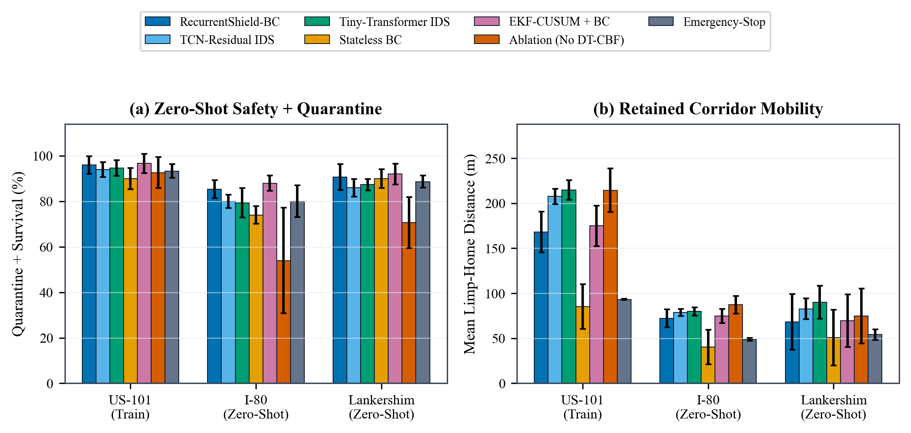

# RecurrentShield-BC

[](paper/recurrent_shield_v2x_ieee.tex)
[-009E73.svg)](data/usdot_manifest.json)
[-82.6%20KB%20%7C%201.70%20ms-E69F00.svg)](edge_deploy/esp32_s3_firmware/model_weights.cc)
[](tests/test_recurrent_shield_suite.py)

**Non-Oracle V2X/GNSS Quarantine and Nonlinear DT-CBF Safety Filtering in Trajectory-Grounded USDOT Corridors.**

`RecurrentShield-BC` is an 84,505-parameter dual-head 128-unit LSTM multi-task behavior cloning (BC) and safety-control architecture evaluated in closed-loop trajectory-grounded simulation over USDOT Next Generation Simulation (NGSIM) trajectories formatted into standardized SAE J2735 Basic Safety Message (BSM) fields.

> **Scope & Provenance Note:** Background vehicles replay recorded USDOT NGSIM frames (`10.21949/1504477`) formatted to match the SAE J2735 / SPMD field schema (`10.21949/1504482`); 6-sector radar ranges, wheel speed, and IMU measurements are synthetically reconstructed over NGSIM geometry rather than measured by physical sensors or captured from raw RF SPMD logs. Outer perception and policy updates execute at 10 Hz (`0.1 s`), DT-CBF reachability verification evaluates 200 Hz numerical substeps (`0.005 s`), and ESP32-S3 timing is analytically projected from Xtensa LX7 cycle models anchored to host CPU benchmarks.

---

## Core Architecture

| Dual-Head LSTM BC + Nonlinear DT-CBF Shield | Zero-Shot Safety & Retained Mobility (5 Seeds) |
| :---: | :---: |
|  |  |

* **Compiled IEEE Manuscript & Source:** [`paper/recurrent_shield_v2x_ieee.pdf`](paper/recurrent_shield_v2x_ieee.pdf) / [`paper/recurrent_shield_v2x_ieee.tex`](paper/recurrent_shield_v2x_ieee.tex).
* **Dual-Head `RecurrentShieldBC` (`models/recurrent_shield_bc.py`):**
  1. **Head 1 — Strictly Non-Oracle Kinematic Residual Quarantine:** Trained via heteroscedastic Gaussian negative log-likelihood (NLL) over 6D discrepancies computed purely from onboard observable radar echoes, curb-anchored dead reckoning, and causal signal-transition/traffic-flow plausibility (zero hidden ground-truth checks).
  2. **Head 2 — Tactical MRM Actor + Exact Monotonic Nonlinear DT-CBF (`control/dt_cbf_safety_shield.py`):** Evaluates 200 Hz numerical substeps with discretization margin $\epsilon_{\text{disc}} = 0.08\text{ m}$ and radar blinding bounds $\epsilon_{\text{radar}} \in \{0.85, 1.85\}\text{ m}$, cleanly separating `100.0%` strict barrier satisfaction across feasible ticks from explicit emergency fallbacks.

---

## USDOT NGSIM Data Reproduction

Trajectories are retrieved from USDOT Socrata REST API and verified via SHA-256 checksums in [`data/usdot_manifest.json`](data/usdot_manifest.json):

| Corridor | Split Role | Records | Vehicles | Raw SHA-256 Prefix |
| :--- | :--- | :---: | :---: | :--- |
| **US-101** (Hollywood Fwy, LA) | Training & Calibration | 33,395 | 227 | `8da1254ce4ff...` |
| **I-80** (Emeryville, CA) | Zero-Shot Highway Eval | 48,397 | 289 | `2c097fac4f59...` |
| **Lankershim Blvd** (Universal City) | Zero-Shot Arterial Eval | 43,142 | 157 | `20180d01aae2...` |
| **50k API Sample** | Endpoint Verification | 49,949 | — | `63633ddc7feb...` |

---

## 5-Seed Multi-Trial Benchmark Summary ($N = 150$ Attack Episodes / Corridor)

Trained strictly on **US-101** across 5 seeds (`101, 202, 303, 404, 505`) via supervised multi-task Behavior Cloning (`Adam`, `lr=2.5e-3`) and evaluated zero-shot on unseen **I-80** and **Lankershim** across `5 seeds × 5 randomized trials × 6 attacks`:

| Corridor | Method | AUROC $\uparrow$ | Delay (ms) $\downarrow$ | Surv. (%) $\uparrow$ | Quar.+Surv. (%) $\uparrow$ | Coll. (%) $\downarrow$ | Dist. (m) $\uparrow$ | Jerk ($\text{m/s}^3$) |
| :--- | :--- | :---: | :---: | :---: | :---: | :---: | :---: | :---: |
| **US-101** | **RecurrentShield-BC** | 0.967 | 547 | 96.0 | 96.0 $\pm$ 3.9 | 4.0 | 168.1 | 6.36 |
| US-101 | Ablation (No DT-CBF) | 0.960 | 540 | 92.7 | 92.7 $\pm$ 6.8 | 7.3 | 214.4 | 1.58 |
| US-101 | EKF-CUSUM + BC | 0.936 | 167 | 96.7 | 96.7 $\pm$ 4.2 | 3.3 | 174.9 | 5.93 |
| US-101 | Emergency-Stop | 0.967 | 595 | 93.3 | 93.3 $\pm$ 3.0 | 6.7 | 93.2 | 7.60 |
| **I-80 (ZS)** | **RecurrentShield-BC** | 0.953 | 1477 | 85.3 | **85.3 $\pm$ 4.0** | 14.7 | 72.3 | 4.66 |
| I-80 | Ablation (No DT-CBF) | 0.954 | 1969 | 54.7 | 54.0 $\pm$ 23.2 | 45.3 | 87.2 | 1.38 |
| I-80 | TCN-Residual IDS | 0.960 | 2140 | 80.0 | 80.0 $\pm$ 3.0 | 20.0 | 78.6 | 5.33 |
| I-80 | Tiny-Transformer IDS | 0.951 | 1944 | 79.3 | 79.3 $\pm$ 6.5 | 20.7 | 79.9 | 5.60 |
| I-80 | Stateless BC | 0.964 | 2363 | 74.0 | 74.0 $\pm$ 3.9 | 26.0 | 40.4 | 4.01 |
| I-80 | EKF-CUSUM + BC | 0.892 | 1133 | 88.0 | 88.0 $\pm$ 3.4 | 12.0 | 74.8 | 4.37 |
| I-80 | Emergency-Stop | 0.943 | 1438 | 80.0 | 80.0 $\pm$ 7.0 | 20.0 | 48.8 | 6.02 |
| **Lankershim** | **RecurrentShield-BC** | 0.965 | 980 | 92.7 | **90.7 $\pm$ 5.7** | 7.3 | 68.2 | 4.18 |
| Lankershim | Ablation (No DT-CBF) | 0.979 | 1642 | 70.7 | 70.7 $\pm$ 11.2 | 29.3 | 74.8 | 1.46 |

* **Exact Feasible DT-CBF Satisfaction:** `100.00%` across all feasible ticks on US-101 (`94.93%` feasible / `5.07%` fallback), I-80 (`93.21%` / `6.79%`), and Lankershim (`95.57%` / `4.43%`).
* **Adaptive Stealth Drift (`results/randomized_onset_eval.json`):** `RecurrentShield-BC` achieves `80.0%` success (`0.0%` collision, `114.5 m`) vs `40.0%` TCN-Residual and `30.0%` Tiny-Transformer.

---

## Analytical ESP32-S3 Footprint (`results/esp32_edge_profile.json`)

| Variant | Weights | Peak SRAM | Proj. Cycles @ 240 MHz | Proj. Latency | Proj. Energy / Step |
| :--- | :---: | :---: | :---: | :---: | :---: |
| **FP32 (ONNX)** | 330.1 KB | 372.1 KB | 1,028,648 | 4.71 ms (`0.471 ms` host) | 1.600 mJ |
| **INT8 (TFLite Micro)** | **82.6 KB** | **107.1 KB** | **322,096** | **1.70 ms** | **0.579 mJ** |
| **DT-CBF Nonlinear Solver** | — | < 1 KB | **3,840** | **0.016 ms** (`0.048 ms` host) | < 0.006 mJ |

---

## Reproduction

```bash
pip install -r requirements.txt
python data/fetch_real_usdot_data.py
pytest -v
python experiments/run_publication_benchmarks.py
python edge_deploy/esp32_s3_export.py
python experiments/plot_ieee_figures.py
```
